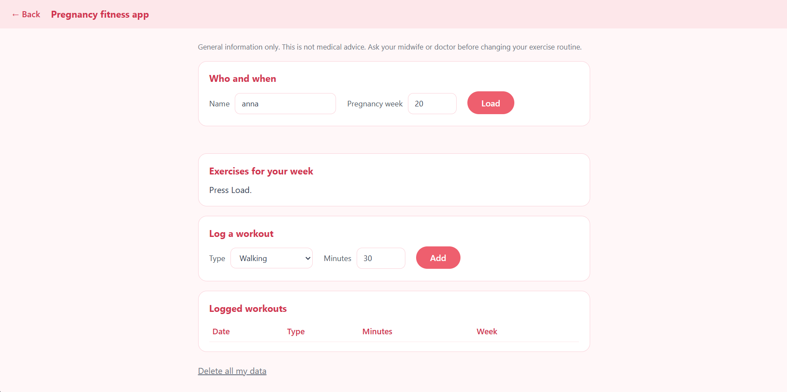

# Pregnancy Fitness App




Microservice-based pregnancy fitness APP built with three Python (FastAPI) microservices and MongoDB, deployable with Docker Compose or Kubernetes.

| Component | Role |
|---|---|
| web-gateway | Serves the UI, aggregates the two backends, the only service exposed outside the cluster |
| workout-service | Stores workouts in MongoDB, the only service that touches the database |
| recommendation-service | Exercise advice by pregnancy week, plus the last 7 days of minutes from workout-service |
| workout-db | MongoDB on a persistent volume |

## Quick start with Docker Compose

```
cp .env.example .env
docker compose up --build
```

Open http://localhost:8080. On Windows PowerShell use `Copy-Item .env.example .env`.

## Run on Kubernetes

```
kubectl apply -f k8s/
kubectl get pods -n pft -w
kubectl port-forward -n pft svc/web-gateway 8081:8080
```

Wait until every pod is `1/1 Running`, then open http://localhost:8081. The manifests are in `k8s/`.

## Scaling note

This is a small app. To make scaling meaningful, assume thousands of users log workouts daily and recommendation logic is CPU-heavy. `SIMULATE_CPU_MS` stands in for that work.
